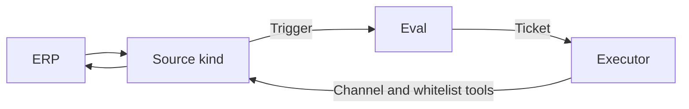

# 010 ERP adapter

The companion sits on an ERP. Swapping the ERP swaps the adapter. Policy, Tickets and the Executor stay.

An adapter is not a new domain concept and not a TypeScript type. It is a [Source](001-domain.md) kind: the kind translates that ERP into Triggers, Threads and a Channel, and it attaches the worker tools that read and write one related record. [008 Cookbook](008-cookbook.md) is how a Source kind is built. This document is what an ERP kind must expose. [009 Odoo](009-odoo.md) is the first implementation.

## What the adapter owns

| Piece | Owns | Leaves alone |
| --- | --- | --- |
| Source kind | Which work items become Triggers, the read position, the agent identity on that ERP, Thread ids and Channel addresses | Eval, Mandates, Tickets |
| Channel | An internal note on the related record, once per outbound message id | Who may ask for the work |
| Policy part | The allowed list, in that ERP's user ids | Mapping those ids to another Source |
| Worker tools | A snapshot of the related record, and writes on the adapter's field whitelist | Stage, owner, revenue, payment, QC release, formal customer notices |

The Engine receives Triggers and sends outbound messages. It does not call the ERP.

## Minimal read surface

Every adapter exposes work assigned to the agent identity on that ERP. Anything the agent created itself is dropped before it becomes a Trigger, the same way a Source drops its own messages.

| Fact | On the Trigger |
| --- | --- |
| Work item id | The Trigger id, derived from the ERP's id so the same item is one Trigger |
| Summary and note | `text` |
| Assignee | The agent identity. The Trigger is addressed to the agent when that identity holds the item |
| Requester | `actor.id`, the ERP user id of the person who created the item |
| Related object | Type and id, in `meta` and in the Thread id. The Channel address names the same record |
| Created | `at` |
| Updated | An edit of the same item keeps the same Trigger id, so it does not open another Ticket |

The related record's snapshot is what companion work reads. For V0 that snapshot is the lead and its contact fields. Sales-order and manufacturing-order progress fields are optional extensions in [SOP extensions](#sop-extensions); a V0 adapter does not have to provide them.

Assessments also read Thread context when the ERP has a conversation on the record, such as chatter. That reader is the kind's `threadContext`. It adds context. It does not authorize work.

## Minimal write surface

Two writes, both limited to the record the Ticket started on.

**Internal note.** The Channel posts one internal note, chatter message or comment on that record. `channel.send` is idempotent by the outbound message id: a retry finds the note already posted and returns `sent`. A deleted record returns `gone`. Any other failure throws so the outbox retries. The worker may also post one result note through a tool; that call is the worker's report. The outbox path is the one that deduplicates.

**Whitelisted fields.** The adapter declares the fields a Ticket may change. The worker tool accepts only those fields, and only values the work item stated. The adapter does not invent a phone, an email or a name. Writing the same stated values again leaves the record as those values.

The adapter does not offer the following. They stay with a person in the ERP. Accepting a Ticket does not authorize them.

| Stays with a person | Examples |
| --- | --- |
| Payment | Approving or releasing a payment |
| Quality | Releasing a QC hold |
| Formal notices | Sending a customer-facing document, including a shipping notice |
| Commercial state | Changing stage, owner or revenue |

## Identity and Policy

Requesters are user ids of that ERP. The allowed list is that Source's part of the Policy, the same shape as every other Source: `{ id, name? }` with `id` in the ERP's own form. Odoo stores integer user ids as text.

Identities on different Sources are never mapped onto each other. That one person also has a GitHub or Feishu account is prompt text when an agent needs it, as [001 Domain model](001-domain.md) already says. A Kingdee, UFIDA or SAP adapter keeps its own user ids in its own Policy part.

## Config

Credentials live in the process environment. They are not settings, not prompt text and not files in git. When the Source is on and a required variable is missing, health reports an error and the poll does not run.

Odoo is the example:

| Variable | Meaning |
| --- | --- |
| `ODOO_URL` | Base URL. Defaults to `http://127.0.0.1:8069`. |
| `ODOO_DB` | Database name. Required. |
| `ODOO_USER` | Login of the user the agent acts as. Required. |
| `ODOO_PASSWORD` | That user's password. Required. |

A later adapter uses its own prefix and the same rule: the connection is environment variables of the `dsh` process, documented on that ERP's page, never committed.

## Idempotence

| Point | Rule |
| --- | --- |
| Trigger id | Derived from the work-item id. `Engine.receive` stores one Trigger per id. A second poll of the same item is a duplicate and does not open a second Ticket |
| Cursor | The Source holds its read position and advances it only for items it has accepted or rejected as unreadable. The first poll records the current high-water mark and emits nothing, so history does not become work |
| Notes | The Channel writes the outbound message id into the note and searches for it before posting again |
| Field writes | Absolute values on the whitelist. A retry sets those fields to the same stated values |

## Odoo V0 mapping

Odoo implements the contract with XML-RPC (`authenticate` on `/xmlrpc/2/common`, then `execute_kw` on `/xmlrpc/2/object`). The code is `src/sources/odoo.ts`, `src/sources/odoo-trigger.ts`, `src/sources/odoo-channel.ts`, `src/sources/odoo-read.ts`, `src/sources/odoo-rpc.ts` and `src/app/tools/odoo.ts`.

| Contract | Odoo V0 |
| --- | --- |
| Work assigned to the agent | `mail.activity` `search_read`. Domain from `activityDomain`: `id` greater than the cursor, `res_model` = `crm.lead`, `user_id` = the authenticated uid. Fields: `id`, `res_model`, `res_id`, `summary`, `note`, `user_id`, `create_uid`, `create_date` |
| Drop the agent's own items | `odooTrigger` returns nothing when `create_uid` is the agent uid |
| Trigger id | `key('odoo', 'activity', activity id)`. The raw id is `meta.activityId` |
| Summary and note | `summary` and `note`, markup stripped, joined into `text` |
| Assignee | `user_id`. `addressed` is `direct` when it is the agent |
| Requester | `create_uid` as `actor.id` |
| Related object | `res_model` and `res_id`. Thread id `crm.lead:<res_id>`. Channel address `{ model, res_id }` |
| Created | `create_date`, read as UTC by `odooTime` |
| Cursor | `KV.odoo.activity` (`odoo-activity-cursor`), `{ afterId }`. `pollActivities` primes it on the first call |
| Lead snapshot | `odoo_search_read` calls `search_read` on that Ticket's `crm.lead`. Fields in `READ_FIELDS`: `id`, `name`, `type`, `partner_id`, `street`, `city`, `website`, `phone`, `email_from`, `contact_name`, `partner_name`, `function`, `description` |
| Thread context | `odooThreadContext` reads `mail.message` on the lead |
| Channel note | `sendOdoo` / `postOdooNote`. Search `mail.message` whose body contains `dsh-superagent:<outbound id>`. Otherwise `message_post` with `message_type` `comment`, `subtype_xmlid` `mail.mt_note` |
| Worker result note | `odoo_message_post`, the same `message_post`, without the outbox marker |
| Whitelist write | `odoo_write` calls `write` on `WRITE_FIELDS` only: `phone`, `email_from`, `contact_name`, `partner_name`, `function`, `description`. Stage, owner and revenue are absent |
| Policy | `odooKind.policy.allowed`: Odoo user ids as text. An activity is an explicit request when one of those users assigns it to the agent on a `crm.lead` |
| Credentials | `ODOO_URL`, `ODOO_DB`, `ODOO_USER`, `ODOO_PASSWORD` via `odooEnv` |

`scripts/odoo-e2e.ts` runs poll, Ticket and the three tools against a live Odoo. A cold poll only records the cursor, so the script takes `--after-id`.

## How to add a second ERP

Follow [008 Cookbook](008-cookbook.md) for the kind, and this contract for what the kind must mean. Kingdee, UFIDA, SAP and any later ERP each get their own kind. They do not share a client, a user id space or a whitelist.

1. Fix the ids first. Trigger id from the work-item id, Thread id from the related record, Channel address as the record a note is posted on. These are stored. Changing them later splits history.
2. Add the kind under `src/sources/`, split the way Odoo is split once translation, Channel and polling are each large enough, and register it from a plugin entry the way `src/sources/odoo.ts` registers `odooKind`. Ship the plugin disabled, as `dsh-superagent-odoo` is.
3. Implement `channel.send` as one internal note, idempotent by outbound message id, `gone` when the record can never take another note.
4. Poll, or the ERP's equivalent, for work assigned to the agent after the cursor. Map each item with the read surface above. Advance the cursor only after the item is received or marked unreadable. Prime the cursor on the first read.
5. Attach worker tools only when the Ticket started on this Source. One read of the related record, one write of the declared whitelist, and the result note if the worker posts one. Refuse every other model and every field outside the whitelist.
6. Add the Policy part: `allowed` entries whose `id` is that ERP's user id. Point the admission row at the business object this kind listens to.
7. Document the environment variables on a numbered page in the style of [009 Odoo](009-odoo.md). Required secrets stay out of git. Missing credentials are a health error.
8. Add an end-to-end script in the style of `scripts/odoo-e2e.ts`: one live work item, the cursor, a whitelist write of values the item stated, and one note. The script prints no secrets and does not start Harness.
9. Keep payment, QC release, formal customer notices, and stage, owner and revenue out of the tools.

## SOP extensions

Later companion work uses this same read and write surface. The fields below are optional extensions an adapter may add when that work starts. They are not required for this contract, and they are not required of Odoo V0.

| Later capability | Extension, when that capability is built |
| --- | --- |
| Production progress | Read fields on the sales order or manufacturing order: state, quantities and dates the chase needs. Still one related record per Ticket |
| Document cross-check | Read-only document or attachment ids on that record |
| Shipping notice draft | A draft the Channel or a tool can store as an internal note. Sending the formal notice stays with a person |

An extension adds fields or a note shape to that adapter. It does not add a path around Policy, and it does not add the operations the write surface leaves with a person.
